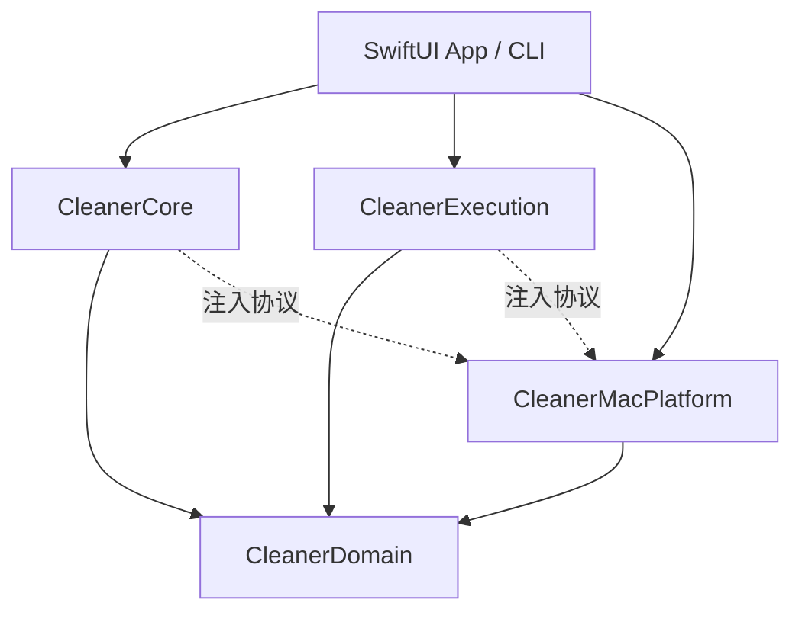

# 技术方案：原生应用与可验证清理内核

版本 v0.1。产品要求见 [PRD](01-PRD.md)，行为契约见 [03](03-CONTRACTS-AND-RULES.md)。以下为自研方案，不声称 CleanMyMac 使用同一实现。

## 1. 技术选型与工程

- Swift 6 language mode，SwiftUI + 必要 AppKit 适配；部署目标 macOS 14，首发 arm64。
- 根 Swift Package：纯领域模型、规则/计划逻辑、macOS 文件系统适配、CLI 和测试。采用标准库/Foundation/CryptoKit、系统 SQLite3，默认无外部运行时依赖。
- 原生 Xcode macOS App 工程引用根 package，本地 shared scheme `LocalMacCleaner`，包含 XCTest UI test target。Swift Testing 用于 package 单元/集成测试，XCTest 用于 App UI 测试。
- v1 为个人本地分发的非 App Sandbox 应用，正常用户权限，无root/helper/自动授权；仍受系统隐私权限控制。开启 Hardened Runtime；本地 ad-hoc 构建与后续正式签名/公证区分记录。不能关闭 Gatekeeper/SIP 来通过测试。
- 非 sandbox 是产品分发选择，不是规避系统权限；扫描范围仍由应用自己严格限制。以后转 App Store 需重新设计 sandbox/bookmark 权限，不能仅改一个开关。

建议未来目录（本轮不创建源码）：

```text
Package.swift
Sources/
  CleanerDomain/           # Codable/Sendable 数据、状态、错误
  CleanerCore/             # 扫描协调、规则、计量聚合、选择和计划
  CleanerMacPlatform/      # Foundation/Darwin/SQLite、卷/进程/文件适配
  CleanerExecution/        # staged transaction，M2才启用
  CleanerCLI/              # scan/plan/fixture 调试入口
Tests/
  CleanerCoreTests/
  CleanerPlatformTests/
  CleanerExecutionTests/
App/LocalMacCleaner.xcodeproj
App/LocalMacCleaner/       # SwiftUI、资源、ViewModel、composition root
App/LocalMacCleanerUITests/
Resources/Rules/           # 自研版本化JSON规则，不放解码专有库
TestSupport/               # 小型fixture定义、独立expected manifest
scripts/                  # 构建、fixture验证与打包脚本（待实现）
docs/development/
.local/                   # 构建、基准、收据、截图；不入Git
```

不要只交 Swift Package 后声称完成原生 app；必须有可复现的 App target、shared scheme、UI test 和 `.app` 制品。优先提交可读 Xcode project；如采用生成器，须固定版本、保存配置并提供无隐含全局依赖的入口。

## 2. 模块与依赖方向



Core/Execution 依赖协议，不反向 import UI。App composition root 连接真实适配器；测试连接独立 fixture/fault adapter。所有生产计划使用同一 Planner；禁止 UI 再实现一份规则或字节求和。

| 接口 | 最小职责 | 禁止职责 |
|---|---|---|
| FileSystemReader | 不跟链接枚举、元数据、文件身份、根/卷校验 | 删除或递归跟随任意路径 |
| VolumeProvider | 卷身份、APFS/只读/本地属性、free-byte sample | 宣称能算精确独占空间 |
| ApplicationActivityProvider | 已知 app/构建进程在用状态：active/inactive/unknown | unknown 推成 inactive |
| RuleRepository + RuleEngine | 加载校验规则，返回带理由的判定 | 执行shell或加载动态脚本 |
| ScanStore | 批量写元数据，分页/聚合查询、失败/取消状态 | 把所有结果一次传给UI |
| Planner | 固定选择集合，拒绝冲突/保护/未知，生成计划 | 自动追加新发现文件 |
| Executor | 准入验证、staging、执行、journal、对账 | 接收任意路径数组绕过计划 |
| ReceiptStore | 事务日志、完整结果、恢复状态 | 自动清除待恢复事务 |

## 3. 扫描流程与并发

1. 将用户所选根转换为卷/目录身份并去重包含关系；Home 与子目录同时选择只遍历一次。
2. 应用保护与遍历策略，遇到 symlink、挂载边界、不可读目录记录条目/缺口，不追目标、不当0字节。
3. 批量枚举属性，后台处理；只读阶段默认不读取文件内容。M3 内容去重另授权设计。
4. 以 device+inode 去重同卷硬链接计量；目录聚合只汇总叶子，不同时计父目录递归值与子项。
5. RuleEngine 产生状态与理由；Store 保存结果和扫描代次；UI分页查询。
6. 每批检查取消。取消后停止调度、清理本次句柄，保留已提交部分结果，并标覆盖不完整。

ScanCoordinator 用 actor 管理代次/取消；一次仅一个扫描，默认2个受限I/O worker，可设置1–4；规则匹配同步纯函数。SQLite连接由store actor串行拥有，每200条或200ms提交一批。UI更新最多每200ms一次，禁止逐文件 MainActor 发布。固定缓冲上限4096条，有背压；这些参数是可测设计默认值。

旧扫描回调必须携带 scanID；与当前代次不同直接丢弃。扫描期间范围/规则变更先取消旧run，再生成新run；不在一个run混用规则版本。

## 4. 本地存储与体积控制

建议位置：`~/Library/Application Support/LocalMacCleaner/`，由系统API解析，禁止硬编码用户名。目录0700，数据库/计划/明细0600。

- `index.sqlite`：scans、entries、issues，必要索引 `(scan_id,parent_id)`、`(scan_id,allocated_bytes)`、`(scan_id,rule_id)`；查询分页；bytes可用64位整数但必须校验溢出。
- `rules/`：自研内置规则随bundle，只读；用户设置/忽略单独JSON原子替换。
- `plans/`：不可变已预览计划与hash；不存授权令牌作为下次免确认凭据。
- `transactions/`：追加、可刷盘journal；目录名transactionID，不覆盖。
- `staging/`：执行中临时同卷隔离。不是备份、不自动按年龄删除、不隐藏它的实际占用。
- `receipts/`：私有结果；UI摘要可长期限量保留，路径明细按PRD期限裁剪；未解决事务不裁剪。

无磁盘空间时：扫描停止并保留部分结果；journal创建/刷盘失败则不开始任何文件移动；计划/收据写入失败不能继续清理后“补日志”。扫描索引超过软上限时停止并提示缩小范围，不能悄悄遗漏后报告完成。

## 5. 计划与执行设计

### M1：纯预览

Planner 输入 scanID、显式选择、动作、规则版本、忽略版本；输出 [03](03-CONTRACTS-AND-RULES.md) 的 CleanupPlan。预检包括身份、保护、卷、在用状态和动作准入。预览不创建目标文件夹、不移动内容。

### M2：执行器安全探针先行

必须先完成 T14 的目录身份/竞态探针；仅 `realpath + 再 stat + removeItem` 不足以证明操作对象未被换掉。

选择普通大文件可以移入废纸篓；永久动作只允许已准入缓存规则的普通文件。拒绝 nlink>1、云占位/同步域、符号链接、跨卷、所有权不符、无法核实活动状态的项。不允许删除目录树；目录候选先展开为固定普通文件清单，保留目录本身及未在计划中的新文件。

统一事务思路：

1. 验证plan hash/版本/确认方式，取得单执行锁，创建并刷盘journal。
2. 通过受限根和逐级不跟链接的目录句柄定位源父目录；比较已记录的祖先/叶子身份。
3. 将当前叶子原子移动到本应用0700同卷staging的唯一位置；**staging不释放空间**。移动后核对被移动对象身份与计划，错配禁止永久操作，进入恢复/人工处理。
4. `trash`：对已核对的staged对象调用系统移入废纸篓API，记录系统返回位置；`purge`：对稳定staging父目录中的固定叶子执行移除。每项前后写journal。
5. 剩余项停止/失败后，不自动扩大选择、不重跑未知结果。对stage未最终处理的项尝试无覆盖恢复；原路径被占用时保留并显示恢复位置。
6. 重启读取未完成journal，按 source/staging/trash/身份核对，分类完成/可恢复/不确定。未知结果不自动重试删除。

上面是需要验证的方案，不是“绝对无竞态”的承诺。非协作进程可在文件打开后继续写入，目录重命名也存在复杂边界。已知活动app先拒绝；无法证明对象身份或隔离效果时保留执行功能禁用，并交付阻塞证据。不要为完成M2改成未经验证的递归删除。

对永久删除不能承诺撤销。Trash阶段保留原始位置与系统返回位置；M2须实现收据驱动的“恢复到原位置”，遇到同名/身份/权限冲突不覆盖。因Trash操作源是staging，不能依赖Finder“放回”自动恢复原路径；细节见契约。取消只停止后续项，不能恢复已永久删除项。

## 6. 权限与错误

所有错误使用稳定code+中文解释+retryable+scope，至少包括 permissionDenied、scopeEscape、unsupportedVolume、protected、activeOwner、activityUnknown、identityChanged、planExpired、rulesChanged、insufficientJournalSpace、stagingMismatch、restoreConflict、interruptedUnknown。

用户拒绝权限不阻断可读范围；权限升级后需要重新扫描，不复用旧“空目录”结果。不能读取其他应用的凭据、cookie或私有运行数据库来判断许可。不能在scan中执行Shell清理命令。

## 7. 构建与运行契约

以下是**待开发者实现后运行**的目标命令，本轮未运行构建/测试：

```sh
xcodebuild -version
xcrun swift --version
xcrun swift test
xcrun swift build -c release
xcodebuild -project App/LocalMacCleaner.xcodeproj -scheme LocalMacCleaner -configuration Debug -destination 'platform=macOS' test
xcodebuild -project App/LocalMacCleaner.xcodeproj -scheme LocalMacCleaner -configuration Release -derivedDataPath .local/build build
```

T01必须让命令与工程实际一致；测试fixture真实根必须由测试创建并绑定身份，不能把Home作为测试目录。产物暂存 `.local/build/`，开发过程不自动复制覆盖 `/Applications`。正式签名、公证、公开分发另行决定。

本机只读探测记录：Xcode26.1.1、Swift6.2.1、SDK26.1，宿主27.0.1；Swift target triple输出与SDK版本不完全同名，不能据此猜测部署兼容性。交接到其他工具必须重新探测 `xcrun` 工具链，不修改全局Xcode选择来掩盖错误。

官方依据（查阅2026-10-12）：[SwiftPM](https://docs.swift.org/main/documentation/packagemanagerdocs/)、[Swift Testing](https://developer.apple.com/xcode/swift-testing)、[FileManager](https://developer.apple.com/documentation/foundation/filemanager)、[URLResourceValues](https://developer.apple.com/documentation/foundation/urlresourcevalues)。具体API可用性以目标SDK编译和运行验收为准。
