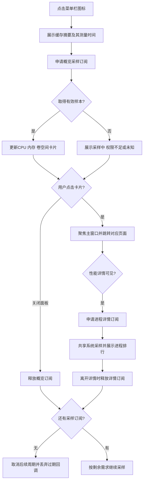
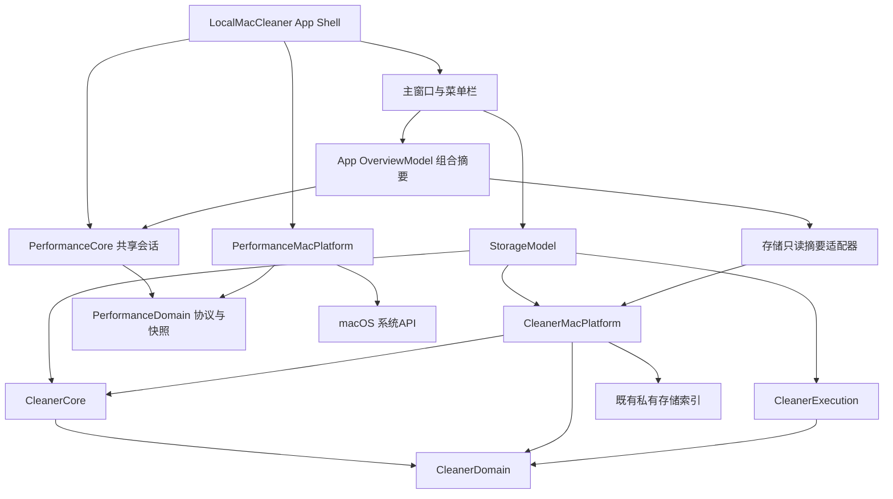
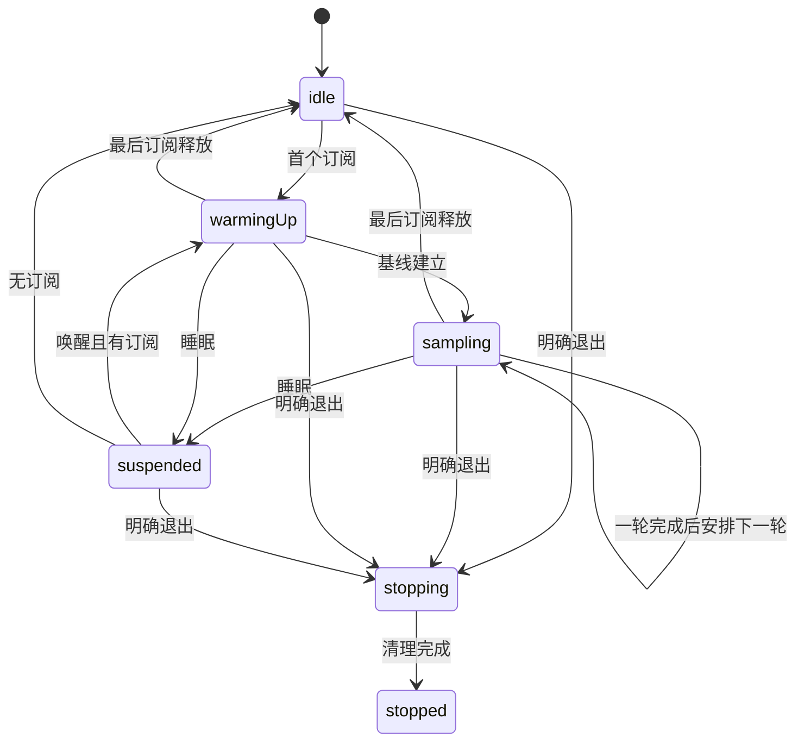

# 需求背景

用户希望以clean-my-mac为主，将旧性能监控融入同一App，并增加菜单栏概览。详细需求见[PRD](01-PRD.md)。当前清理工程已经按Domain/Core/Platform/Execution分层；旧监控是单一可执行target，采样、界面对象和操作耦合。方案保留清理内核，新增性能模块与App组合层，避免把全局概览变成第二套扫描/采样实现。

本文所有新增接口、图和状态为拟实现设计，未运行验证。实施需先交接当前开发，不覆盖正在修改的App与扫描代码。

# 核心业务流程

## 菜单概览与详情



CPU首样本只建立基线；卷空间可以一次读取。已有存储扫描独立运行；上述打开/关闭都不发起扫描、不改变选择集合、不清理文件。已有扫描摘要只能标为历史扫描，实时空间不会刷新其时间。

## 主窗口关闭、睡眠与退出

关闭主窗口释放该窗口可见页的订阅，保留用户启用的菜单入口及已发起的存储任务。隐藏菜单入口不创建常态采样；用户能从主窗口设置重新启用。
睡眠暂停性能调度，唤醒清空CPU差值基线和旧回调代次，有订阅时恢复采样。
明确退出：禁止新采样，取消采样订阅，按既有存储任务/恢复契约协调停止；若既有执行服务要求等待或持久化，沿用该行为，不能强制终止绕过。完成后退出进程。

# 技术架构

## 模块关系



图表示拟实施依赖，不表示已有性能target。AppDependencies创建唯一共享会话，将Platform采集实现注入Core。Core不import Platform。Overview只组合摘要与路由，不掌握删除或退出进程能力。

| 模块 | 功能与实现 |
|---|---|
| PerformanceDomain | Sendable纯快照、指标状态、进程身份、原始采集协议；不含NSImage或SwiftUI |
| PerformanceCore | actor维护采样代次/订阅；纯计算器处理CPU差值、排序与过滤；限制历史窗口 |
| PerformanceMacPlatform | 系统CPU/内存、进程API及卷空间读取；将系统错误映射为质量状态；原始CPU单位在适配边界统一 |
| PerformanceModel | MainActor界面状态，订阅流、搜索排序、表格数据；图标按需缓存且有上限 |
| OverviewModel | 聚合性能/空间/任务摘要，保持各自时间和覆盖；不重新计算清理候选 |
| Shell | 入口注册、导航、窗口聚焦、退出协调及依赖装配 |
| 存储摘要适配器 | 调用届时现有Store/任务接口；只读查询，不改schema、不创建新扫描 |

候选UI采用MenuBarExtra.window，支持卡片与按钮。若实机焦点/关闭可见性不满足，再记录原因改为NSStatusItem + NSPopover；无独立进程或IPC需求。[Apple文档](https://developer.apple.com/documentation/swiftui/menubarextra)

## 工程与数据

继续根Swift Package、多target与Xcode App；Swift6/macOS14+与当前清理基线一致。App仍引用本地package。目标目录及迁移见[目录方案](03-DIRECTORY-AND-MIGRATION.md)。
性能快照只保留最多60轮内存历史，此数为初始预算。进程CPU差值仅保留当前身份及上一有效样本，退出后裁剪。不按PID无限累计历史。
设置分别用performance.* / overview.*命名；不自动导入旧App偏好。既有扫描索引、计划、事务路径和schema不变。日志限量、私有，不记录完整命令参数与内容。

# 技术难点分析

## 1. 指标校准与PID复用

旧CPU实现注释与计算可能存在单位解释差异，实施时用真实API头文件/官方资料确认。系统CPU以tick差值计算占比；进程累计CPU转换成统一纳秒后除以单调经过时间，避免重复timebase换算。计数倒退/异常、首次采样、睡眠后样本都重建基线，不填0冒充已测。
进程身份至少包含PID与可靠启动标识；无法读取启动标识时允许展示当次RSS/name，但不计算跨轮CPU、不提供操作能力。PID复用必须丢弃旧历史。physical footprint失败显示缺失，虚拟内存不替代；I/O/GPU未采集就是unsupported。

实机准确性对照采用有边界、持续稳定的自建负载进程，记录Activity Monitor读数及时间；界面刷新差异不能要求逐帧完全相等。不能退出用户原有进程作为测试。

## 2. Actor不等于后台线程

actor串行保护状态；它不保证同步采集不在MainActor或不阻塞执行器。Platform隔离阻塞API，批量、有限并发，禁止逐进程并发Task爆炸；App只在MainActor应用快照。Core actor重入期间使用generation与inFlight防重复；lease变更后重新评估需求，旧结果不发布到新会话。
以可注入单调时钟与FakeSampler验证计划；生产可用ContinuousClock等合适时钟。采集延迟超预算时标采样延迟并跳过周期，不叠加。取消不能承诺打断所有同步系统调用：取消后不得再次调度，已开始结果按代次丢弃；测量调用必须有界并记录最坏耗时。
[Swift并发依据](https://docs.swift.org/swift-book/LanguageGuide/Concurrency.html)

## 3. 两入口订阅与生命周期

一个system loop按订阅需求合并：overview要系统/卷空间，detail要系统/进程。系统采样取最短有效间隔，但首版统一2秒。进程仅detail存在时采集；卷空间仅overview存在时采集。
SwiftUI onAppear/onDisappear须先实机验证菜单面板行为；重复appear不能产生多个lease。每个consumer稳定ID与一个lease，release幂等；流终止也释放。共享服务生命周期由App持有，不由某张卡持有。禁用菜单入口必须显式释放对应lease。
首版无持续告警，因此双方隐藏后零周期采样；已有存储任务可继续。

## 4. 时间与覆盖不能混合

每个指标保存sampledAt、质量、来源与原因。系统CPU/内存6秒、空间30秒后标stale；保留旧值并显示时间，不清为0。历史扫描不套用实时空间阈值，仍显示扫描时间及partial/cancelled/unknown。
未发现某进程不是文件unused证据；既有ApplicationActivityProvider仍可unknown。菜单观察不能开ExecutionGate，不能通过“Free Up”快捷路径绕过计划。

## 5. 资源与窗口

面板先画缓存/加载态，再异步采集。菜单可见与应用焦点分开；不复制旧isAppActive开关。主窗口聚焦/路由使用同一窗口标识，不重复创建StorageModel和数据库连接。
资源预算按[验收](04-ACCEPTANCE.md)测试。任何改预算都要记录版本/原因，不能只因测试失败就放宽。电池、网络等未来功能先明确采样需求，再接入，不能共享一个永不停止的全局轮询。

# 接口和状态设计

以下Swift为拟实施契约示意，非可直接编译的既有源码；实际类型名称可工程化细化，语义不可降低。

```swift
enum MetricQuality: String, Codable, Sendable {
    case measured, warmingUp, permissionDenied, unsupported, unknown, failed
}
struct Metric<Value: Codable & Sendable>: Codable, Sendable {
    let value: Value?
    let quality: MetricQuality
    let sampledAt: Date?
    let source: String
    let reason: String?
}
// stale是展示层根据时间推导的时效，不覆盖原始quality。
struct ProcessIdentity: Hashable, Codable, Sendable {
    let pid: Int32
    let startToken: UInt64 // 已核实来源；未知身份不构造此类型
}
struct ProcessSnapshot: Sendable {
    let pid: Int32
    let identity: ProcessIdentity?
    let name: String
    let cpuPercent: Metric<Double>
    let residentBytes: Metric<UInt64>
    let footprintBytes: Metric<UInt64>
}
struct SystemSnapshot: Sendable {
    let cpuPercent: Metric<Double>
    let memoryUsedBytes: Metric<UInt64>
    let memoryTotalBytes: Metric<UInt64>
    let pressure: Metric<String> // 实施时用已验证的类型化压力等级
}
struct VolumeSnapshot: Sendable {
    let volumeID: String?
    let availableBytes: Metric<UInt64>
}
enum SamplingDemand: Sendable { case overview, detail }
protocol PerformanceSampler: Sendable {
    func readSystem() async -> RawSystemSample
    func readProcesses() async -> RawProcessSample
    func readStartupVolume() async -> VolumeSnapshot
}
// RawSystemSample/RawProcessSample为适配层原始读数、
// 单调时间与逐项错误的类型，实施时补齐，并在领域层声明。
```

measured必须value非空且sampledAt有效；其他状态不能用0代替缺失。pressure具体枚举由PO-05确认，其未知分支始终保留。原始读数只能进入计算器，Overview不接触CPU原始计数。

| 接口 | 输入/输出 | 重要语义 |
|---|---|---|
| acquire(consumerID,demand) | 返回lease及有界快照流 | 同consumer不得重复采样；注册后按需求启动 |
| release(lease) | 无；幂等 | 最后订阅退出后取消后续调度 |
| suspend/resume | 睡眠/唤醒事件 | 唤醒重置差值基线、代次 |
| snapshot() | 最近各项快照 | 不隐式启动周期工作，可能为空/过期 |
| storageSummary() | 既有扫描/任务只读摘要 | 返回scanID、时间、覆盖、状态；无新扫描 |
| navigate(route) | storage/performance/settings | 聚焦已有主窗口，再应用路由 |
| shutdown() | 服务停止结果 | 与原存储退出契约协调；不直接kill进程 |

快照流buffer建议仅保留最新一项，不让慢UI累计队列；每lease取消自身流，只有最后需求释放才停共享服务。消费者崩溃/销毁后的清理需要测试而非仅依赖deinit。



单项测量失败不终止整个App；返回quality与reason，并按正常有限节奏重测，不额外产生快速重试环。stopped终态不接受新lease。存储ScanState/TransactionState仍属于原模块，不强行映射为性能状态。
